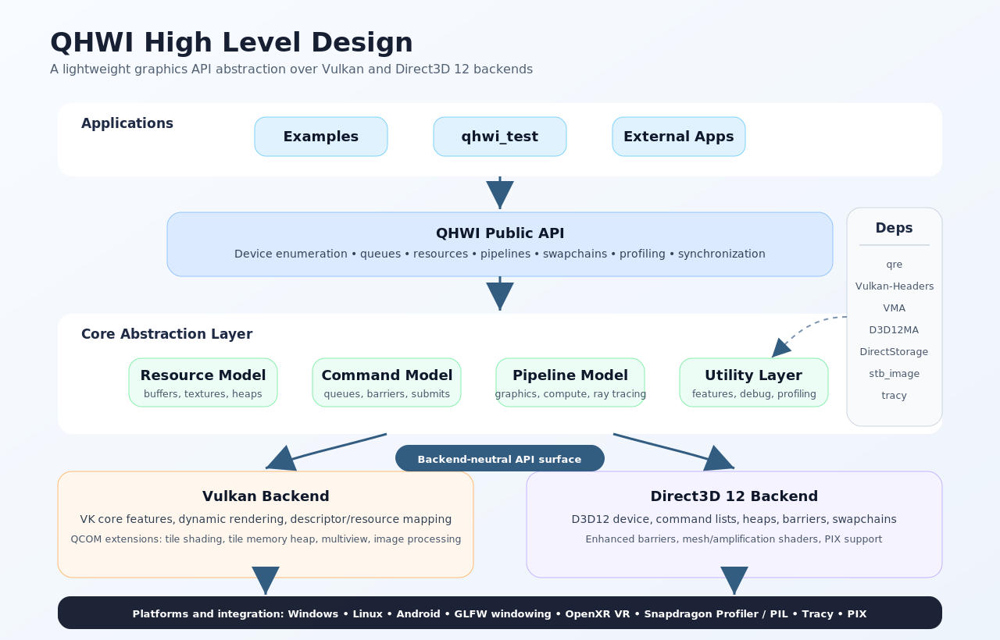

# QHWI

[](LICENSE.txt)
[](CONTRIBUTING.md)

QHWI (Qualcomm Hardware Interface) is a modern, high performance graphics API abstraction library over multiple graphics backends: *Vulkan* and *DirectX 12*.  Its primary use case is to support programming the GPU through a simplified, common interface.

## Motivation
- QHWI is used internally at Qualcomm to support various other projects such as 3D rendering engines, etc.
- QHWI provides several benefits, including:
  - Support the latest features and extensions, especially Qualcomm extensions
    - Measure and communicate performance benefits of extensions and optimization techniques
  - Provide sample code that demonstrates best practices for Adreno GPUs
  - Prototype / test experimental extensions

## Goals
- Achieve optimal performance on Qualcomm GPUs
  - Leverage the latest features and extensions
  - Optimize for UMA (unified memory architecture)
  - Optimize for tiled GPU architecture (leverage tiled memory)
  - Minimize CPU overhead
- Support profiling
    - Leverage Qualcomm debugging / profiling / testing tools such as Snapdragon Profiler
- Simplified programming model
    - Reduced complexity compared to Vulkan or DirectX 12

## Features

Supports:
- Graphics, compute pipelines
- Devices, GPU queues
- Device enumeration, feature query
- Mesh, amplification shaders
- Ray queries
- Ray tracing acceleration structures
- Render to texture
- Multiple render targets
- Multisampling (MSAA)
- Multiple texture types: 2d, 3d, 2d array, cubemap
- Swapchains
- Window creation
- Bindless rendering model
- GPU profiling using timer queries
- Explicit resource barriers
- Automatic resource barriers
- Single-pass mipmap generation
- HDR rendering
- MultiView
- VR rendering
- Specialization constants (Vulkan)
- D3D12 enhanced barriers
- Dynamic rendering with local read (Vulkan, via VK_KHR_DYNAMIC_RENDERING_LOCAL_READ)
- Various Qualcomm extensions:
  - VK_QCOM_IMAGE_PROCESSING
  - VK_QCOM_MULTIVIEW_PER_VIEW_VIEWPORTS
  - VK_QCOM_MULTIVIEW_PER_VIEW_RENDER_AREAS
  - VK_QCOM_TILE_PROPERTIES
  - VK_QCOM_TILE_SHADING
  - VK_QCOM_TILE_MEMORY_HEAP
  - VK_QCOM_RENDER_PASS_SHADER_RESOLVE
- Hardware accelerated optical flow
  - Uses VK_NV_OPTICAL_FLOW extension
  - This extension is supported on various Qualcomm devices

## High Level Design


## Dependencies

QHWI is lightweight, with minimal dependencies.

It has the following required dependencies:

- *qre*
    - Various data structures and support functions optimized for real-time graphics applications
      - allocates memory on stack (StaticVector) for optimal performance
      - SIMD-optimized math functions (NEON / SSE)

- *[d3dx12](https://github.com/microsoft/DirectX-Headers/blob/main/include/directx/d3dx12.h)*
    - Provides a utility header for d3d12
    - Required only when D3d12 backend is enabled

In addition, it has the following optional dependencies:

- *[glfw](https://www.glfw.org/)*
    - Optional window backend for Windows, Linux, and Mac OS
    - Provides a common abstraction API for creating windows
    - The qhwi_test app uses GLFW to support rendering onscreen
    - This is also used by the examples
- *[OpenXR](https://github.com/KhronosGroup/OpenXR-SDK)*
    - Supports VR rendering

## Building

### Configuration

QHWI is highly configurable.

The build system provides the following options:
- *QHWI_ENABLE_D3D12_BACKEND*: enable the D3D12 backend (available on Windows, ON by default)
- *QHWI_ENABLE_VULKAN_BACKEND*: enable the Vulkan backend (available on Windows, Linux, Android, ON by default)
- *QHWI_BUILD_UNIT_TESTS*: build the QHWI unit tests
- *QHWI_BUILD_EXAMPLES*: build the QHWI examples
- *QHWI_ENABLE_COMPRESSED_STORAGE*: enable fast, GPU-targeted asset loading with optional on-the-fly decompression — DirectStorage on D3D12, and Vulkan's `VK_EXT_memory_decompression` + GDeflate tile decoding on Vulkan (OFF by default; see [Compressed Storage](#compressed-storage) below)
- *QHWI_ENABLE_QCOM_TILE_SHADING*: enable the use of `VK_QCOM_tile_shading` (requires *QHWI_ENABLE_VULKAN_BACKEND*)
- *QHWI_ENABLE_TRACY*: enable Tracy profiling support
- *QHWI_TRACY_GPU_BACKEND*: Tracy GPU profiling backend to use (`dx12`, `vk`, or `NONE`; requires *QHWI_ENABLE_TRACY*)
- *QHWI_ENABLE_SER*: enable Shader Execution Reordering support on D3D12 (requires Shader Model 6.9 preview drivers)
- *QHWI_ENABLE_PIX_SUPPORT*: enable PIX capture support (requires *QHWI_ENABLE_D3D12_BACKEND*)
- *QHWI_LINUX_WSI*: Linux windowing system to target — `xlib`, `xcb`, or `wayland`
- *QHWI_PIL_DIR*: path to the root of an extracted PIL package
- *QHWI_ENABLE_PIL*: set to `OFF` to disable PIL even when `QHWI_PIL_DIR` is set (auto-enabled when `QHWI_PIL_DIR` is valid)

The GLFW window backend is used automatically on non-Android platforms whenever unit tests or examples are built; there is no separate toggle for it.

Multiple graphics backends can be enabled on some platforms (e.g. both *D3d12* and *Vulkan* can be enabled simultaneously on *Windows*)

### Compressed Storage

*QHWI_ENABLE_COMPRESSED_STORAGE* gates a family of APIs (`qhwi::compressedstorage::*`) for loading — and optionally decompressing — assets straight into GPU-visible memory, bypassing the regular CPU upload path. What backs it differs per graphics backend:

- **D3D12**: uses Microsoft's [DirectStorage](https://github.com/microsoft/DirectStorage) runtime (`dstorage.lib`/`dstorage.h`) for the actual file I/O and queuing, with GDeflate as one of its supported decompression codecs.
- **Vulkan**: has no DirectStorage dependency. Decompression runs via the `VK_EXT_memory_decompression` extension; only two small GDeflate header-only pieces (the `TileStream` layout and default tile size) are needed to parse the same tile-stream format DirectStorage produces, so pre-compressed assets can be shared across both backends.

Both backends are exposed through the same backend-agnostic `qhwi::compressedstorage` types (`File`, `Factory`, `StorageQueue`, `Request`) — the namespace name reflects that shared abstraction rather than either vendor-specific implementation. When the option is OFF (the default), none of this code is compiled and the `external/DirectStorage` submodule is never fetched.

### Windows Build Instructions

1.  Install Prerequisites
- CMake (3.26.1 or newer)
- Visual Studio: (2019 or newer)
- Vulkan SDK (1.3.239.0 or newer, if enabling Vulkan backend)

2.  Clone the Repo
- git clone <repository-url> --recursive

3.  CMake Setup

    *cmake -S . -B <build_dir>*

- Visual Studio should automatically be the default generator
- To confirm, run cmake without any parameters
- To use Visual Studio backend: add cmake generator param *-G "Visual Studio 17 2022"*
  - or *-G Visual Studio 16 2019* to use VS 2019

4.  Open the generated Visual Studio project file

5.  Build *qhwi_test* in Visual Studio.
- Can also build from command line:

    *cmake --build qhwi_test --config Debug*

## Android Build

1.  Install Prerequisites
- Android Studio (2022.3.1.19 or newer)
- Android NDK (23.1.7779620 or newer)
- CMake (3.26.1 or newer)

2.  Open *qhwi_test* project from test/android

3.  Press the *run* or *debug* button to build and install the APK

Alternatively, can build from command line:
- cd test/android
- ./gradlew assembleDebug (or assembleRelease)

## Examples

- gpl
  - Demonstrates how to use Vulkan's graphics pipeline libraries.
  - Includes various configuration options to help measure cpu and gpu performance.
  - Performance measures include linking and rendering with both monolithic and gpl constructed pipelines
  - Includes several different shader types to fine tune analysis
- qcom_image_proc
  - Demonstrates hardware-accelerated image processing on Qualcomm GPUs using VK_QCOM_IMAGE_PROCESSING extension
- qcom_multiview
  - Demonstrates how to use QCOM multiview extensions
- qcom_tile_shading
  - Demonstrates tile shading render pass mode using VK_QCOM_TILE_SHADING extension (Android only)
- qcom_tile_memory_heap
  - Demonstrates tile memory heap/buffer usage via VK_QCOM_TILE_MEMORY_HEAP extension (Android only)
- vk_custom_resolve
  - Demonstrates MSAA resolve using VK_QCOM_RENDER_PASS_SHADER_RESOLVE, with fallback to VK_EXT_custom_resolve or standard MSAA resolve (Vulkan only)
- vr
  - Renders a spinning cube to a VR headset using OpenXR
  - Supports PC VR streaming via Oculus Link (Vulkan and D3d12)
  - Supports running as a native Android VR app (tested on Quest2)

### Troubleshooting

1.  The C++ files don't show in Android Studio
- Build -> Refresh Linked C++ Projects

2.  CMake / Ninja reports path size is too long
- Windows has a path length limitation of 260 bytes
- Can try removing the path limitation in the registry:
[Remove path limitation][https://learn.microsoft.com/en-us/windows/win32/fileio/maximum-file-path-limitation?tabs=registry]

### Notes
- CMake build script packages all the shaders as part of Android APK (in assets folder)
- CMake build script also downloads / packages the Vulkan prebuilt validation layer

## Running the Unit Tests

> **Note:** QHWI has an extensive `ctest`-based unit test suite. GitHub Actions CI currently only verifies that the project *builds* on each supported platform — it does not run the test suite, since that requires a GPU-equipped runner. Run the tests locally (see below) before submitting a pull request.

To run all the unit tests:
```
cd build/test
ctest -C Debug -j
```

ctest supports various parameters:  
- run *ctest --help* for more details
 
ctest internally invokes *qhwi_test* for each test

*qhwi_test* provides a command line interface
- run *qhwi_test --help* for a description of the command line arguments

TODO: add instructions for Android

### Running a specific test on Android

Push a `config.txt` to the device before launching the app. The file accepts the same arguments as the desktop `qhwi_test` command line:

```bash
adb shell "mkdir -p /sdcard/Android/data/com.qualcomm.qhwi_test/files"
adb shell "echo '--tests=test_graphics_pipeline --backends=vk' > /sdcard/Android/data/com.qualcomm.qhwi_test/files/../config.txt"
```

The app reads `config.txt` on startup and runs only the matching tests. To go back to running all tests, delete the file:

```bash
adb shell "rm /sdcard/Android/data/com.qualcomm.qhwi_test/files/../config.txt"
```

## Debugging

### [Snapdragon® Profiler (SDP)](https://qpm.qualcomm.com/#/main/tools/details/SnapdragonProfiler) and [Profiler Interface Library (PIL)](https://qpm.qualcomm.com/#/main/tools/details/ProfilerInterfaceLibraryWindows)

- SDP is a GPU profiling tool for Adreno GPUs that supports capture and real-time metrics on Windows ARM64 and Android
- PIL is the programmatic C++ API that connects to SDP at runtime to query GPU performance counters and metrics
- Platform support: Windows ARM64, Android (ARM64)

**Setup:**

1. Download the PIL package from QPM:
   - Windows: [Snapdragon® Profiler Interface Library (Windows)](https://qpm.qualcomm.com/#/main/tools/details/ProfilerInterfaceLibraryWindows)
   - Android: [Snapdragon® Profiler Interface Library (Android)](https://qpm.qualcomm.com/#/main/tools/details/ProfilerInterfaceLibraryAndroid)
2. Extract the package to a directory of your choice
3. Set `QHWI_PIL_DIR` to the root of the extracted package:
   - **CMake:** `-DQHWI_PIL_DIR=<path-to-PIL>`
   - **Android Studio (examples):** add `QHWI_PIL_DIR=<path-to-PIL>` to your `local.properties` file
4. `QHWI_ENABLE_PIL` will be set automatically when `QHWI_PIL_DIR` is valid; set it to `OFF` explicitly to disable PIL even when `QHWI_PIL_DIR` is set

**Runtime:** SDP must be running on the host (or connected Android device) for PIL metrics to be available. SDP is available from QPM: [Snapdragon® Profiler](https://qpm.qualcomm.com/#/main/tools/details/SnapdragonProfiler)

## Third-party Dependencies

QHWI bundles the following third-party libraries as git submodules under `external/`.
These are used as-is under their respective licenses and are **not** modified by this project.

| Library | License | Purpose |
|---------|---------|---------|
| [Vulkan-Headers](https://github.com/KhronosGroup/Vulkan-Headers) | Apache-2.0 / MIT | Khronos Vulkan API headers and registry |
| [VulkanMemoryAllocator](https://github.com/GPUOpen-LibrariesAndSDKs/VulkanMemoryAllocator) | MIT | GPU memory allocation for Vulkan |
| [D3D12MemoryAllocator](https://github.com/GPUOpen-LibrariesAndSDKs/D3D12MemoryAllocator) | MIT | GPU memory allocation for D3D12 |
| [DirectStorage](https://github.com/microsoft/DirectStorage) | MIT | Microsoft DirectStorage runtime and GDeflate codec |
| [tracy](https://github.com/wolfpld/tracy) | zlib | Frame and zone profiling instrumentation |
| [stb_image](https://github.com/nothings/stb) | MIT / Public Domain | Single-header image loading |
| [qre](https://github.com/qualcomm/qre) | BSD-3-Clause-Clear | Qualcomm runtime engine utilities (containers, OS abstraction) |

See each submodule's own `LICENSE` or `LICENSE.txt` for the full license text.

## Contributors

Thanks to everyone who has contributed to QHWI, including authors listed below, and anyone else we may have missed!

- Alan Hickman
- Fiona Wright
- Francesco Giancane
- Gauthier Germain
- Gayatri Dhore
- Janardhan Haryadi Ramesh
- Jeffrey Moguillansky
- Juraj Obert
- Kashyap Rajpal
- Luka Pandza
- Marcos Ibanez Matles
- Mark Feldman
- Mark Golden
- Mauricio Maurer
- Preetish Kakkar
- Rishiraj Manwatkar
- Rommel Bhargava
- Ronan Quill
- Samarth Mabrukar
- Veera Ajay Kumar Karanam
- Wade Lutgen

## Contributing

We welcome contributions! Please see our [Contributing Guide](CONTRIBUTING.md) for details on how to submit pull requests, build the project locally, and adhere to our coding standards.

Please note that this project is released with a [Contributor Code of Conduct](CODE_OF_CONDUCT.md). By participating in this project, you agree to abide by its terms.

## License

This project is licensed under the BSD-3-Clause-Clear License. See [LICENSE.txt](LICENSE.txt) for details.
