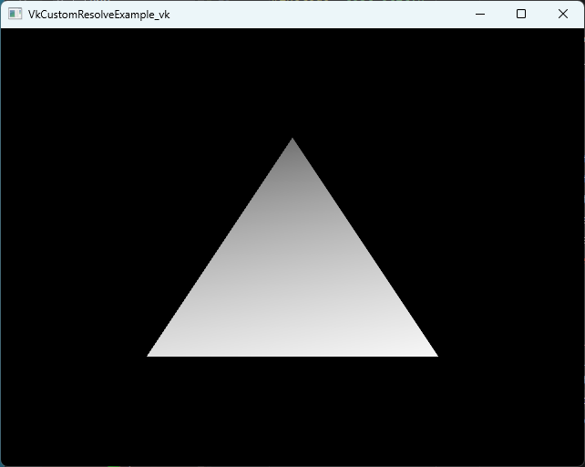
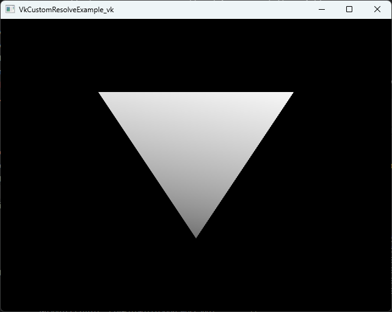

# `VK_EXT_custom_resolve`/`VK_QCOM_render_pass_shader_resolve` example

This example demonstrates MSAA (Multi-Sample Anti-Aliasing) resolve on Vulkan with three different
resolve strategies, selected at runtime based on hardware support and the `--custom_resolve` flag.
The rendered scene is a gradient color triangle; the resolve step converts it to grayscale using
the ITU-R BT.709 luminance weights — making the visual difference between paths easy to verify.

---

## Rendering

**Pass 1 — Gradient draw:**
A centered triangle (3 vertices, no vertex buffer) is rasterized into a 4× MSAA color attachment. The gradient shader (`gradient.hlsl`) assigns each fragment a color derived from its UV coordinates:

```hlsl
float r = uv.x;          // red increases left → right
float g = uv.y;          // green increases top → bottom
float b = 1.0 - (uv.x + uv.y) * 0.5;  // blue fades toward bottom-right
```

The result is a smooth RGB gradient covering the triangle.

**Pass 2 — Resolve + tonemap:**
A full viewport quad is rendered, sampling from the render target filled in the previous step. The 4× MSAA samples are resolved, and a grayscale conversion is applied using BT.709 luminance:

```
luma = 0.2126·R + 0.7152·G + 0.0722·B
```

Because all three paths apply the same grayscale formula, the output image looks identical regardless
of which path is taken. The difference is *how* the resolve happens, not what you see.

| `--custom_resolve` | Standard resolve |
|:------------------:|:----------------:|
|  |  |

---

## The Three Resolve Paths

The path taken is determined at startup by probing the device for extension support:

```
--custom_resolve flag set?
        │
        ├─ YES ──► VK_EXT_custom_resolve available? ──► YES ──► Path A: VK_EXT_custom_resolve
        │                                               NO  ──► VK_QCOM_render_pass_shader_resolve?
        │                                                            YES ──► Path B: QCOM shader resolve
        │                                                            NO  ──► fall back to Path C
        │
        └─ NO  ──► Path C: standard driver MSAA resolve
```

```cpp
// init(), deciding which path to take
m_supportsCustomResolve = customResolveRequested && m_device->supportsCustomResolve();
m_supportsQcomShaderResolve = !m_supportsCustomResolve && customResolveRequested
                              && vkDevice->isExtensionEnabled(VK_QCOM_RENDER_PASS_SHADER_RESOLVE_EXTENSION_NAME);
```

### Why Custom Resolve Helps

The benefit is not the grayscale math itself; all paths apply the same filter. The benefit is where
the MSAA samples live while that filter runs.

In the `VK_EXT_custom_resolve` path, the two steps are dynamic-rendering passes; in the
`VK_QCOM_render_pass_shader_resolve` path, they are subpasses in one `VkRenderPass`. The memory
story is the same in both cases.

On tile-based GPUs, rasterization can keep attachment data in on-chip TILE memory. The custom
resolve paths take advantage of that by writing the MSAA samples, then reading those samples back as
an input attachment (`SubpassInputMS`) before they have to be written out to external DDR memory.
That lets the shader apply the custom filter while the data is still local to the tile.

Without a custom resolve path, the renderer has to use the standard fixed-function resolve flow. The
MSAA image is completed as a normal attachment, the driver resolves it into a separate 1x texture,
and the next pass reads that texture from external memory to apply the tonemap/filter. That extra
store-and-load through DDR is the bandwidth cost this sample is designed to show.

| Path | First step | Filter step | Main memory implication |
|------|------------|-------------|-------------------------|
| Custom resolve (`VK_EXT_custom_resolve` or `VK_QCOM_render_pass_shader_resolve`) | Write 4x MSAA samples to TILE memory | Read MSAA samples from TILE memory as an input attachment, apply custom filter | Avoids the intermediate resolved texture traffic |
| Standard resolve | Write/resolve the MSAA result through the normal attachment path | Read the 1x resolved texture in a later pass, apply the same filter | Adds external DDR write/read bandwidth |

### Path A — `VK_EXT_custom_resolve` (preferred)

This is the primary focus of the example. The extension allows a shader to perform the resolve step
itself, replacing the fixed-function hardware resolve that the driver would otherwise apply.

**How it works — two independent dynamic-rendering passes:**

| Pass | Attachment | Load / Store | Purpose |
|------|-----------|-------------|---------|
| 1 (Gradient) | MSAA texture (`eRgba8Unorm`, 4×) | Clear → Store | Rasterize the gradient into MSAA samples |
| 2 (Custom Resolve) | MSAA texture (input) + swapchain (resolve target) | Load → Store | Shader reads all 4 samples, writes grayscale to swapchain |

Pass 2 uses `VK_RENDERING_CUSTOM_RESOLVE_BIT_EXT` (set automatically by QHWI when
`beginRenderPass(..., customResolve=true)` is called). The MSAA texture is bound as both
a color attachment and a `SubpassInputMS` input attachment. QHWI automatically emits the
local-read barrier.

The custom resolve shader (`vk_custom_resolve.hlsl`) reads each of the 4 MSAA samples explicitly:

```hlsl
[[vk::input_attachment_index(0)]]
SubpassInputMS<float4> msaaColor : register(t0);

float4 PSMain(VSOutput input) : SV_TARGET
{
    float4 sum = 0;
    [unroll] for (int i = 0; i < 4; i++)
        sum += msaaColor.SubpassLoad(i);
    float4 resolved = sum / 4.0;                          // manual box average
    float luma = dot(resolved.rgb, float3(0.2126, 0.7152, 0.0722));
    return float4(luma, luma, luma, 1.0);
}
```

Key points:
- `SubpassInputMS<float4>` — the HLSL type that maps to `subpassInputMS` in GLSL / SPIR-V.
- `[[vk::input_attachment_index(0)]]` — the Vulkan-specific HLSL attribute binding this resource
  to input attachment index 0 in the renderpass (no sampler needed; the GPU reads on-chip).
- `SubpassLoad(i)` — loads sample *i* from the current fragment's location without a texture
  fetch, keeping all data on-tile.
- The MSAA texture is created with `TextureUsage_InputAttachment` in addition to
  `TextureUsage_ColorAttachment` so it can serve both roles.
- The pipeline is created with `customResolve = true` and `sampleCount = e1` (the resolve
  pipeline targets a 1× output, not 4×).

**Command recording — Path A:**
```cpp
// Pass 1: gradient → MSAA, no explicit resolve
commandList->beginRenderPass(1, &msaaDesc, nullptr);
commandList->bindGraphicsPipeline(m_gradientPipeline.Get());
commandList->draw(3);
commandList->endRenderPass();

// Pass 2: custom resolve → swapchain
commandList->beginRenderPass(1, &customResolveDesc, nullptr, nullptr, /*customResolve=*/true);
commandList->beginCustomResolve();        // transitions to resolve phase
commandList->bindGraphicsPipeline(m_customResolvePipeline.Get());
commandList->bindDescriptorSet(m_customResolveDescSet.Get(), ...);
commandList->draw(4);                     // full-screen quad (triangle strip)
endRenderPass(commandList);
```

---

### Path B — `VK_QCOM_render_pass_shader_resolve` (Qualcomm legacy path)

This path is used when `--custom_resolve` is requested but `VK_EXT_custom_resolve` is not
available, and the older Qualcomm extension `VK_QCOM_render_pass_shader_resolve` is present.

The legacy extension predates dynamic rendering and requires the explicit `VkRenderPass` object
API. This means the example cannot use QHWI's high-level `beginRenderPass`/`endRenderPass`
wrappers and must call raw Vulkan through `beginVkRenderPass` / `nextSubpass` / `endVkRenderPass`.

**Structure — a single render pass with two subpasses:**

| Subpass | Attachment(s) | Flags | Purpose |
|---------|--------------|-------|---------|
| 0 | MSAA (`eR8G8B8A8Unorm`, 4×) as color | — | Gradient draw |
| 1 | MSAA as input + swapchain as color | `VK_SUBPASS_DESCRIPTION_SHADER_RESOLVE_BIT_QCOM` | Shader-driven resolve |

The `VK_SUBPASS_DESCRIPTION_SHADER_RESOLVE_BIT_QCOM` flag tells the driver that this subpass
performs a custom resolve; no separate resolve attachment slot is used.

**Subpass dependencies:**
Three `VkSubpassDependency` entries are required:
1. `EXTERNAL → subpass 0`: orders the prior frame's MSAA storeOp before this frame's clear.
2. `EXTERNAL → subpass 1`: gates swapchain writes on the acquire semaphore stage.
3. `subpass 0 → subpass 1`: makes MSAA samples written in subpass 0 readable as an input
   attachment in subpass 1 (`COLOR_ATTACHMENT_WRITE` → `INPUT_ATTACHMENT_READ`).

The resolve shader is identical to Path A's `vk_custom_resolve.hlsl` — the same
`SubpassInputMS` + `SubpassLoad(i)` pattern, reused across both paths.

**Command recording — Path B:**
```cpp
vkCmdList->beginVkRenderPass(renderPassBeginInfo);

// Subpass 0: gradient
cmd.bindPipeline(..., m_qcomGradientPipeline.get());
cmd.draw(3, 1, 0, 0);

vkCmdList->nextSubpass();

// Subpass 1: QCOM shader resolve
cmd.bindPipeline(..., m_qcomResolvePipeline.get());
cmd.bindDescriptorSets(..., m_qcomResolveDescSet, ...);
cmd.draw(4, 1, 0, 0);

vkCmdList->endVkRenderPass();
```

Because the render pass `finalLayout` for the swapchain attachment is `ePresentSrcKHR`, QHWI's
barrier tracker is notified manually after the pass:
```cpp
commandList->notifyState(m_swapchain->getCurrentImage(), TextureState_Present);
```

---

### Path C — Standard driver MSAA resolve (fallback)

Used when `--custom_resolve` is not passed, or when neither extension is available.

The driver performs a fixed-function box-filter average of the 4 MSAA samples into a separate
resolved texture (`m_resolvedTexture`). A second render pass then runs the tonemap shader
(`tonemap.hlsl`) to sample that texture and output grayscale to the swapchain.

**Structure — two render passes:**

| Pass | Input | Output | Operation |
|------|-------|--------|-----------|
| 1 (MSAA + Resolve) | — | MSAA texture + `m_resolvedTexture` | Driver averages 4× → 1× |
| 2 (Tonemap display) | `m_resolvedTexture` (sampled) | Swapchain | Grayscale via tonemap shader |

The tonemap shader (`tonemap.hlsl`) samples the resolved texture with a standard `Texture2D` +
`SamplerState`, unlike the custom paths which use `SubpassInputMS`.

**Command recording — Path C:**
```cpp
// Pass 1: gradient draw with automatic driver resolve
msaaResolveDesc.setResolveTexture(m_resolvedTexture.get());  // driver resolves here
commandList->beginRenderPass(1, &msaaResolveDesc, nullptr);
commandList->bindGraphicsPipeline(m_gradientPipeline.Get());
commandList->draw(3);
commandList->endRenderPass();

// Pass 2: tonemap the resolved texture to the swapchain
commandList->beginRenderPass(1, &tonemapOutputDesc, nullptr);
commandList->bindGraphicsPipeline(m_tonemapPipeline.Get());
commandList->bindDescriptorSet(m_tonemapDescSet.Get(), ...);
commandList->draw(4);
endRenderPass(commandList);
```

---

## Shader Details

### `gradient.hlsl`

Vertex shader generates a centered triangle from `SV_VertexID` (no vertex buffer). Three
hardcoded clip-space positions occupy the middle half of the screen:

```hlsl
const float2 Pos[] = { float2(0.0, -0.5), float2(-0.5, 0.5), float2(0.5, 0.5) };
const float2 UV[]  = { float2(0.5, 0.0),  float2(0.0, 1.0),  float2(1.0, 1.0) };
```

The pixel shader assigns color from UV coordinates:
```hlsl
float r = uv.x; float g = uv.y; float b = 1.0 - (uv.x + uv.y) * 0.5;
```

### `vk_custom_resolve.hlsl` (used by Paths A and B)

The vertex shader emits a full-screen quad (4-vertex triangle strip). The pixel shader branches
on the `SPIRV` define:

| Compile target | Resource | Access |
|----------------|----------|--------|
| SPIRV (Vulkan) | `SubpassInputMS<float4>` | `SubpassLoad(i)` per sample — on-tile, zero bandwidth |
| Non-SPIRV (unused) | `Texture2D` + `SamplerState` | Standard `Sample()` — for portability reference |

The `[[vk::input_attachment_index(0)]]` attribute is a DXC Vulkan extension that injects the
SPIR-V `InputAttachmentIndex` decoration; without it the subpass attachment binding is
undefined. It has no equivalent in DXIL.

### `tonemap.hlsl` (Path C only)

Full-screen quad vertex shader + pixel shader that samples `Texture2D resolvedColor` with a
`SamplerState`. Applies the same BT.709 grayscale conversion. Used only on the standard path
because the resolved data must be read as a regular texture sample across render passes.

---

## Resource Summary by Path

| Resource | Path A | Path B | Path C |
|----------|--------|--------|--------|
| MSAA texture usage flags | `ColorAttachment \| InputAttachment` | `ColorAttachment \| InputAttachment` | `ColorAttachment` |
| Resolved texture | None (writes direct to swapchain) | None (writes direct to swapchain) | `m_resolvedTexture` (separate 1× target) |
| `SubpassInputMS` | Yes | Yes | No (`Texture2D` sampled) |
| Render pass API | Dynamic rendering (`VkRenderingInfo`) | `VkRenderPass` + `VkFramebuffer` | Dynamic rendering |
| Number of passes / subpasses | 2 passes | 1 pass / 2 subpasses | 2 passes |

---

## Building

### Windows (Desktop)

```bash
cmake -B build -DQHWI_BUILD_EXAMPLES=ON
cmake --build build --target qhwi_example_vk_custom_resolve
```

### Android

Open `examples/vk_custom_resolve/android/` in Android Studio, or build from the command line:

```bash
cd examples/vk_custom_resolve/android
./gradlew assembleDebug
```

Requirements:
- NDK `23.1.7779620`
- `compileSdk 33`, `minSdkVersion 28`
- ABI: `arm64-v8a`

---

## Running

### Windows

Default (standard resolve path):
```bash
./vk_custom_resolve.exe
```

Enable custom resolve (uses VK_EXT_custom_resolve or VK_QCOM_render_pass_shader_resolve if available):
```bash
./vk_custom_resolve.exe --custom_resolve
```

### Android

Install the APK:
```bash
adb install app/build/outputs/apk/debug/app-debug.apk
```

Launch (standard resolve):
```bash
adb shell am start com.qualcomm.qhwi_example_vk_custom_resolve/android.app.NativeActivity
```

Launch with custom resolve enabled:
```bash
adb shell am start \
  -n com.qualcomm.qhwi_example_vk_custom_resolve/android.app.NativeActivity \
  --es args "--custom_resolve"
```

Stop the app:
```bash
adb shell am force-stop com.qualcomm.qhwi_example_vk_custom_resolve
```

View logs:
```bash
adb logcat -T1 -s Graphics
```


---

## Verifying Which Path Ran

Check the logcat output for the path selection log lines emitted during `init()`:

```
VkCustomResolveExample: supportsQcomShaderResolve=0   # Path A or C depending on VK_EXT_custom_resolve
VkCustomResolveExample: supportsQcomShaderResolve=1   # Path B
```

If custom resolve was requested but neither extension is available, you will see:
```
Custom resolve was requested but neither VK_EXT_custom_resolve nor
VK_QCOM_render_pass_shader_resolve is available; falling back to standard MSAA resolve.
```

GPU frame captures (RenderDoc, Snapdragon Profiler) will show:
- **Path A**: two `vkCmdBeginRendering` regions; the second has `VK_RENDERING_CUSTOM_RESOLVE_BIT_EXT`
- **Path B**: one `vkCmdBeginRenderPass` with two subpasses; subpass 1 has `SHADER_RESOLVE_BIT_QCOM`
- **Path C**: two `vkCmdBeginRendering` regions; the first includes a resolve attachment

---

## Key Extension APIs

| Extension | Core API used | QHWI wrapper |
|-----------|--------------|--------------|
| `VK_EXT_custom_resolve` | `VK_RENDERING_CUSTOM_RESOLVE_BIT_EXT` in `VkRenderingInfo` | `beginRenderPass(..., customResolve=true)` + `beginCustomResolve()` |
| `VK_QCOM_render_pass_shader_resolve` | `VK_SUBPASS_DESCRIPTION_SHADER_RESOLVE_BIT_QCOM` in `VkSubpassDescription` | None — raw Vulkan via `beginVkRenderPass` |
| Standard resolve | `pResolveAttachments` in `VkSubpassDescription` / `resolveImageView` in `VkRenderingAttachmentInfo` | `setResolveTexture()` on `ColorAttachmentDescription` |

---

## Performance on Snapdragon GPU (Mobile)

Measurements collected on a device with a Snapdragon GPU using Snapdragon Profiler. The app ran
for several seconds under each mode; values shown are the **per-sample peak** over the capture
window.

### Peak Bandwidth

| Metric | Standard resolve | Custom resolve | Reduction |
|--------|-----------------|---------------|-----------|
| Texture Memory Read BW | ~259.1 MB/s | ~8.73 MB/s | **96.6%** |
| GPU Write Total | ~1,695 MB/s | ~275.9 MB/s | **83.7%** |
| GPU Read Total | ~389.5 MB/s | ~129.8 MB/s | **66.7%** |
| Disk physical write | ~68.94 MB | ~1.44 MB | **97.9%** |
| Disk physical read | ~6.59 KB | ~99 B | **98.5%** |

All values in MB/s or MB:

```mermaid
%%{init: {'theme': 'base', 'themeVariables': {'xyChart': {'plotColorPalette': '#C0504D,#4472C4'}}}}%%
xychart-beta
    title "Peak values: standard resolve (red) vs custom resolve (blue)"
    x-axis ["Texture Read BW", "GPU Read Total", "GPU Write Total", "Disk Write", "Disk Read"]
    y-axis "MB / MB/s" 0 --> 1800
    bar [259.1, 389.5, 1695, 68.94, 660]
    bar [8.73, 129.8, 275.9, 1.44, 10]
```



> 🟥 Standard resolve — 🟦 Custom resolve
>
> Disk read values multiplied by 100,000 for visibility (actual values: ~0.0066 MB standard, ~0.0001 MB custom resolve).

### Analysis

**Texture Memory Read BW** shows the strongest signal — a ~97× reduction. On the standard path
the driver reads all 4 MSAA samples from external memory to resolve them. With `SubpassLoad()`,
those reads come from on-tile storage; the data never crosses the memory bus.

**GPU Write Total** drops ~6×. The standard path writes both the 4× MSAA surface and the 1×
resolved texture to memory. The custom resolve path writes only the final swapchain image — the
MSAA surface stays on-tile and is discarded at `endRenderPass`.
